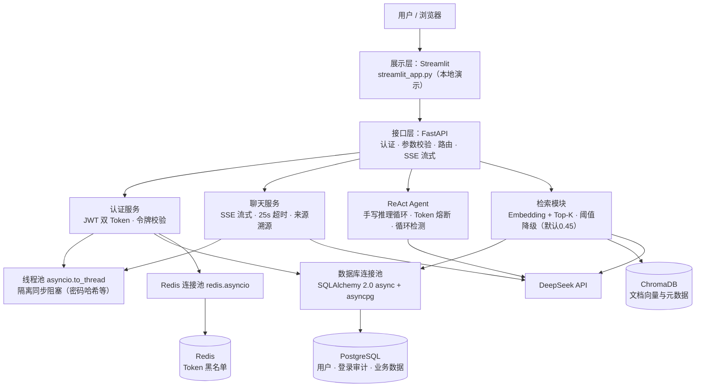
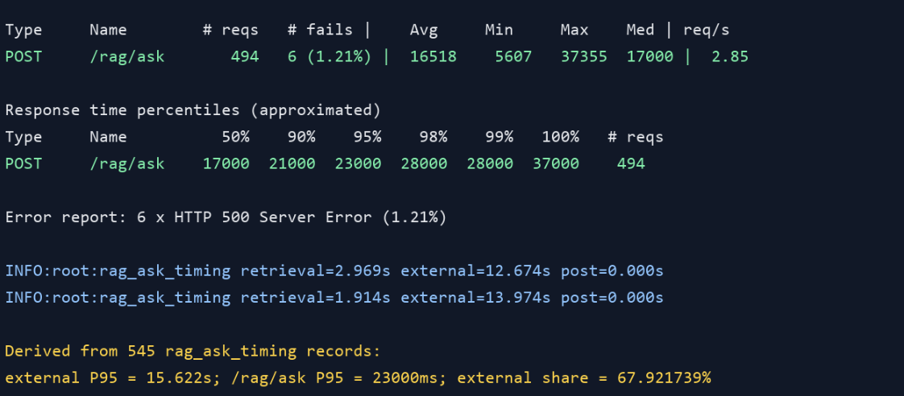

# FastAPI AI 应用后端

一个带完整认证、RAG 检索和 ReAct Agent 的 FastAPI 后端，已部署在 <https://baisonghao.website>，接口文档见 `/docs`（演示账号 `demo / demo123`）。

## 功能

- 认证：注册 + 邮箱激活、登录、JWT 双 Token（access + refresh）、登出（Redis 黑名单）
- AI 对话：SSE 流式输出，25s 超时兜底，客户端断开检测（断开即停，不白烧上游 token），回答附带检索来源
- RAG：ChromaDB 向量检索（余弦空间），距离归一化 + 相似度阈值降级纯模型回答（默认 0.45，env `RAG_SIMILARITY_THRESHOLD` 可调，按 bge-large-zh 在本库实测标定）
- Agent：手写 ReAct 推理循环（没有用 LangChain），max_iter=5 + Token 累计熔断 + 连续重复动作短路（loop_detected）；工具：RAG 检索（top1 低于阈值时返回低置信度警告）/ 网络搜索 / 计算器 / Python 执行器（模块白名单沙箱）
- 可观测：JSON 结构化日志（stdout）、loguru 链路耗时、请求耗时中间件（X-Process-Time）
- 迁移：Alembic（0001 users，0002 login_logs 登录审计，0003 users.token_version）

## 技术栈

FastAPI · SQLAlchemy 2.0（async）· PostgreSQL / SQLite · ChromaDB · Redis（Upstash）· DeepSeek · Docker / Railway

## 架构



## 快速开始

```bash
python -m venv venv
venv\Scripts\activate        # Windows；Linux/macOS 用 venv/bin/activate
pip install -r requirements.txt
# 按需配置 .env（本地开发不配 DATABASE_URL 会用 SQLite）
uvicorn main:app --reload
```

启动时自动完成三件事：SQLAlchemy 幂等建表、创建演示账号、检查向量库（旧 L2 集合自动重建为 cosine 并灌入 `documents/` 下的文档）。

## 环境变量

| 变量 | 说明 | 默认 |
| --- | --- | --- |
| `DATABASE_URL` | PostgreSQL 连接串，不配则本地 SQLite | `sqlite+aiosqlite:///test.db` |
| `SECRET_KEY` | JWT 签名密钥（**必填**） | 无有效默认值：仍是占位串则拒绝启动 |
| `DEEPSEEK_API_KEY` | DeepSeek 对话 / Agent | - |
| `SILICONFLOW_API_KEY` | RAG 嵌入（BAAI/bge-large-zh-v1.5） | - |
| `REDIS_URL` | Upstash / 托管 Redis（`rediss://` 或 `redis://`） | - |
| `REDIS_HOST` `REDIS_PORT` `REDIS_PASSWORD` `REDIS_DB` | Redis 独立配置（没有 REDIS_URL 时用） | `localhost:6379` |
| `BASE_URL` | 激活链接前缀 | `https://baisonghao.website` |
| `ACCESS_TOKEN_EXPIRE_MINUTES` | access token 有效期 | `30`（分钟） |
| `REFRESH_TOKEN_EXPIRE_MINUTES` | refresh token 有效期 | `10080`（7 天） |
| `ACTIVATION_TOKEN_EXPIRE_MINUTES` | 激活链接有效期 | `10`（分钟） |
| `TAVILY_API_KEY` | Agent 的 `web_search` 工具 | 空 = 工具返回降级提示 |
| `RAG_SIMILARITY_THRESHOLD` | RAG 置信度阈值（归一化 0~1），低于则降级纯模型回答 | `0.45` |
| `RAG_BENCHMARK_TOKEN` | 压测用 Bearer，可免 JWT 调 `/rag/*`（生产勿设） | 空 = 不生效 |
| `PASSWORD_HASH_ROUNDS` | 密码哈希成本（sha256_crypt rounds） | `60000` |
| `DEBUG` | 允许在 `SECRET_KEY` 未替换时启动（**仅本地调试**） | `false` |
| `RAG_REBUILD_TOKEN` | 手动触发向量库重建接口的鉴权 | 空 = 接口禁用 |

## 接口

前缀 `/api/v1`，除 register / activate / login 外都需要 `Authorization: Bearer <token>`。

| 方法 | 路径 | 说明 |
| --- | --- | --- |
| POST | `/register` | 注册，返回激活链接 |
| GET | `/activate?token=` | 激活账号 |
| POST | `/login` | 登录，返回 access + refresh |
| POST | `/refresh` | refresh 换新 token 对（旧 refresh 立即作废，做轮换） |
| POST | `/logout` | 登出，access / refresh 进黑名单 |
| POST | `/logout-all` | 全端登出，递增 `token_version` 吊销该用户全部 token |
| GET | `/users/me` | 当前用户（含最近登录时间） |
| POST | `/chat` | SSE 流式对话，带来源溯源 |
| POST | `/agent` | ReAct Agent |
| POST | `/rag/retrieve` | 检索，返回片段 + 相似度分数 |
| POST | `/rag/ask` | 检索 + 模型回答（阈值降级） |
| POST | `/rag/local_search` | 纯本地检索（压测用） |
| POST | `/rag/rebuild` | 重建向量库并灌库（需 `RAG_REBUILD_TOKEN`，未配置则禁用） |

## 踩过的坑

- **Upstash 强制 TLS**：`redis://` 连接被服务端直接关闭（`Connection closed by server`），改用 `rediss://` 协议解决；所有连接加 5s 超时，避免连不上时启动卡死。redis-py 5.x 的 `from_url` 不支持 `ssl=` 参数，TLS 要用 `rediss://` 协议写
- **chromadb metadata 会撒谎**：`get_or_create_collection` 会悄悄改写已存在集合的 metadata，看起来是 cosine 实际还是 L2。用自有标记 `dsh_schema` 记录真实检索空间，旧库启动时自动删除重建
- **向量库增量维护**：文档新增/改写后，启动时按内容 id 增量补灌并清理过期片段，不需要手动重建
- **SQLite 事务**：连接串走 `aiosqlite`，异步 ORM 与同步建表并存，启动时幂等建表

## 已知缺口（分级 + 最小补法）

### 已补最小版（边界即讲解素材）

- **SSE 断开检测**：轮询（每个 chunk yield 前）+ finally 兜底双路径。本地 uvicorn 实测发现：客户端断开时 Starlette 的 `StreamingResponse.listen_for_disconnect` 会取消流响应任务，生成器在 await 点退出，轮询点（循环开头）来不及执行；故在 finally 补一次检测——断开后 finally 里 `is_disconnected()` 返回 True（uvicorn 断开时 `send` 静默 return 不抛错，轮询是唯一主动手段）。上游流由 `async with` 退出时自动 `aclose()`。未做：背压控制、断点续传
- **ReAct 循环检测**：连续两轮给出完全相同的 (Action, Action Input) 即 `exit_reason=loop_detected` 退出，且退出前不重复执行工具。边界：只抓连续重复（A→A），A→B→A 这类交替重复抓不到，仍由 max_iterations 兜底；要抓交替模式需要维护动作频率窗口，是更重的一档

### 未补缺口（按影响面 × 触发概率分级）

| 优先级 | 缺口 | 影响 | 最小补法 |
| --- | --- | --- | --- |
| P1 | SSE 无心跳 | 中间层（Nginx / 网关）空闲超时会掐断长连接；本项目上游 25s 超时兜底 + Railway 无此类配置，实际触发概率低 | 生成器里用 `asyncio.wait_for` 包上游迭代，超时未收到数据就 `yield ": keep-alive\n\n"` |
| P1 | SSE 无背压 | 客户端消费慢时服务端仍全速吐数据，chunk 在内存驻留 | 有界队列 + `await queue.join()`，或按写缓冲区水位暂停读上游 |
| P2 | 日志无 trace_id | 一次请求跨认证 / 检索 / LLM 三段，出问题难按请求串起来 | 中间件生成 uuid 存 contextvars，loguru JSON sink 统一带出 |
| P2 | Python 执行器无内存限制 | 已有 AST 白名单 + 1s 超时 + 子进程隔离三重防护，只缺内存维度 | 子进程内 `resource.setrlimit(RLIMIT_AS, ...)` 限制地址空间 |
| P3 | register 的哈希没进 to_thread | 注册瞬间阻塞事件循环约 51ms（rounds=60000 实测），量小但存在 | 注册路由同样 `await asyncio.to_thread(hash_password, ...)` |
| P3 | 事务提交点分散 | commit 散在路由与 Service 层，异常路径依赖全局 handler 兜底 | Service 层统一 async context manager 管 commit / rollback |

## 性能测试

压测条件：Locust，50 并发，持续 3 分钟，覆盖 `/rag/ask`（正式压测前手动预热 10 次）。

| 指标 | `/rag/ask` |
| --- | --- |
| 请求数 | 494 |
| 失败 | 6（1.21%） |
| 平均耗时 | 16519 ms |
| P95 | 23000 ms |
| P99 | 28000 ms |
| 最大 | 37356 ms |



分段日志（`rag_ask_timing`）显示 external（DeepSeek 调用）的 P95 为 15.6s，占接口 P95 的 67.9%，瓶颈在外部 LLM，不在检索。

### 登录接口压测（2026-08-17 实测）

压测方法：50 并发，持续 30 秒，直压登录接口（demo 账号）。优化前后对比：

| 阶段 | 单请求 P50 | 50 并发 P95 | 失败率 |
| --- | --- | --- | --- |
| SQLite + 哈希 rounds=535000 | 527 ms | 10.3 s（伴随 `database is locked`） | 66% |
| PostgreSQL + 旧哈希 | 612 ms | 13.4 s | 0% |
| **PostgreSQL + rounds=60000 + 线程池16/连接池10** | **408 ms** | **2.0 s** | **0%** |

主要优化：① 数据库从 SQLite 迁移到 PostgreSQL（SQLite 并发写锁会连读请求一起阻塞）；② 密码哈希成本 rounds 535000 → 60000（单次验证 457ms → 51ms）；③ `asyncio.to_thread` 线程池 8 → 16、连接池 5+5 → 10+10。登录审计写入做了降级容错，写失败不影响登录主流程。

## RAG 效果评估

150 条测试问题（100 条文档内、50 条文档外），人工标注对比纯模型与 RAG 的回答准确率：

- 纯模型 61% → RAG 79%，相对提升 29.5%（150 条人工标注，阈值 0.6 时期实测；阈值下调至 0.45 后待复测）
- 测试集仍在扩充中

## 部署

- **Railway（当前）**：`nixpacks.toml` + `Procfile`，PostgreSQL + Upstash Redis + 环境变量。
  部署前必须先在 Railway → Variables 配好 `SECRET_KEY`（随机串），否则进程会因启动守卫直接退出
- **Docker**：仓库自带 `Dockerfile`（streamlit 演示版）和 `docker-compose.yml`（FastAPI + Redis 双容器）

## 知识库维护

文档放进 `documents/`（txt / md，空行分段），重启服务自动增量入库，不用手动重建向量库。
